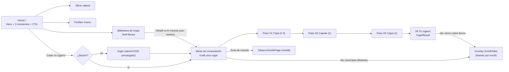
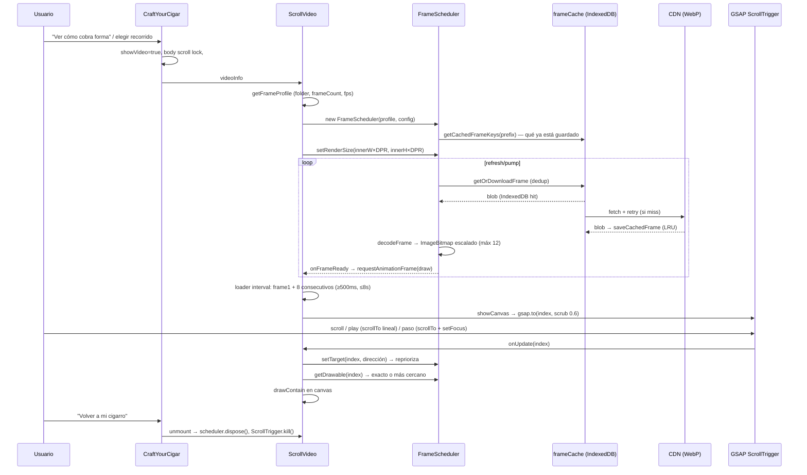
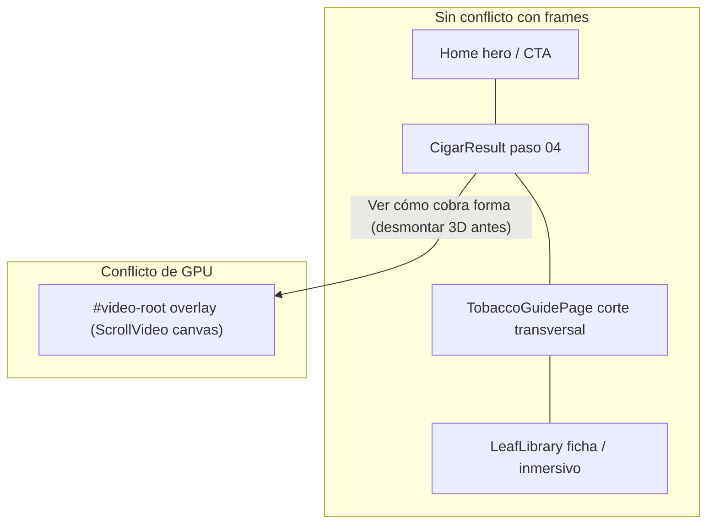

# TOBACCO — Auditoría del proyecto (Frontend, UX/UI y sistema de frames)

> **Referencia histórica de exploración (19/10/2026).** H1/O2/L1/ART-C1 se implementaron después; tecnología, cifras y tareas de este documento describen aquella fase. Consultar [estado vigente](3d-exploration/PROGRESS.md) y [pendientes del proyecto](STATUS.md). Los encargos y restricciones de sesiones anteriores no son instrucciones actuales.

> Fecha: 2026-10-19 · Alcance: repositorio `tobacco` (rama `main`, commit `0451152`).
> Documento solo de análisis: no se modificó código, no se instalaron dependencias y no se alteró la secuencia de frames.
>
> Convención usada en el documento:
> - **[Confirmado]**: comprobado en el código, con la ruta del archivo.
> - **[Interpretación]**: lectura de diseño o UX, no verificable en el código.
> - **[Desconocido]**: el repositorio no permite saberlo.

---

## 1. Executive Summary

- **[Confirmado]** TOBACCO es una SPA con React 19 y Vite 7 para **Tabacalera Tamboril** (Tamboril, República Dominicana). El recorrido es editorial: hojas, mezcla, oficio y, al final, una "mesa de composición" donde el usuario arma su cigarro (tripa, capote y capa) y ve cómo "cobra forma" en una **secuencia de frames WebP 4K** pintada en `<canvas>` y controlada por scroll (GSAP ScrollTrigger).
- **[Confirmado] Corrección importante a la premisa del encargo:** la secuencia de frames **no está en la página principal** (`/`). Vive en `/craft-your-cigar`, una ruta **protegida por un login simulado** (`admin/1234`), y se abre como overlay a pantalla completa (`src/pages/CraftYourCigar.jsx`, `src/components/ScrollVideo.jsx`). La Home (`src/pages/Home.jsx`) es una landing editorial estática con una imagen hero.
- **[Confirmado]** El motor de frames es sofisticado: tiene un scheduler con prioridades, caché IndexedDB LRU de 750 MB, decodificación con `ImageBitmap` escalado, fallback al frame más cercano y precarga en segundo plano. También es **pesado**: unos 1,6 MB por frame y unos 743 frames por secuencia a 30 fps (~1,2 GB por secuencia), servidos desde un CDN externo (`cdn.mbsoft.freeddns.org`).
- **[Confirmado]** En la documentación interna (`docs/scroll-video-performance-audit.md`) el cuello de botella medido es la **decodificación** (~143 ms de media, p95 189 ms por bitmap de 2880×1620), no la red.
- **[Confirmado]** Hay deuda heredada importante: `index.html` sigue cargando una plantilla de cafetería (Bootstrap 4, jQuery, OwlCarousel, Tempus Dominus, Font Awesome y `main.js`) que en la práctica no se usa. Además, el panel interno de diseño y rendimiento (botón engranaje) es visible para todos los visitantes.
- **Conclusión 3D:** el stack ya incluye GSAP y framer-motion, y la arquitectura admite elementos 3D ligeros. Sin embargo, **dentro del overlay de frames la GPU y el hilo principal ya están al límite** por la decodificación. Ahí no conviene meter WebGL. Los puntos de integración 3D con más sentido están **fuera de la secuencia**: Home, el resultado de la mezcla y la guía. Antes conviene priorizar las mejoras de bajo riesgo de UX y rendimiento.

---

## 2. What is TOBACCO?

| Pregunta | Respuesta | Evidencia |
|---|---|---|
| ¿Qué es? | **[Confirmado]** Experiencia web de presentación para "Tabacalera Tamboril", con el lema "Del cultivo al cigarro". | `index.html` (title), `src/i18n/locales/es/navigation.json`, `src/i18n/locales/es/seo.json` |
| Propósito | **[Confirmado]** "Descubrir la materia prima, comprender la mezcla y observar cómo nace un cigarro". **[Interpretación]** Es una vitrina de marca y herramienta educativa o comercial; no hay tienda ni checkout. | `navigation.json` (footer), ausencia de lógica de compra |
| Historia que cuenta | **[Confirmado]** Hoja (origen, textura y función), luego mezcla (capa, capote y tripa), luego oficio (selección, composición y elaboración), luego "tu cigarro" y su elaboración frame a frame. | `src/pages/Home.jsx:12-16`, `src/pages/CraftYourCigar.jsx:222` (comentario del recorrido) |
| Cómo empieza | **[Confirmado]** Hero a pantalla completa con `/img/carousel-1.jpg`, kicker "Tamboril, República Dominicana", H1 "El carácter comienza en *la hoja.*" y 2 CTA (Explorar hojas / Descubrir el oficio). | `src/pages/Home.jsx:21-34`, `src/i18n/locales/es/pages.json` |
| Público | **[Confirmado]** Adultos ("Contenido dirigido a adultos"). **[Desconocido]** Si es B2C, B2B o uso en punto de venta o feria. | `src/components/layout/Footer.jsx` |
| Producto real vs. demo | **[Confirmado]** El login es simulado, los formularios no envían ("Esta versión aún no envía formularios") y varios datos de las fichas están "pendientes". **[Interpretación]** Es una demo o presentación avanzada, todavía no un producto en producción completo. | `src/store/authStore.js:13`, `src/pages/Login.jsx:14`, `src/components/leaf-library/TechnicalSheet.jsx:20` |

---

## 3. Technology Stack

**[Confirmado]** según `package.json`:

| Capa | Tecnología | Versión | Uso real |
|---|---|---|---|
| Framework | React + React DOM | ^19.1.1 | SPA completa (`src/main.jsx`) |
| Build | Vite + `@vitejs/plugin-react` | ^7.1.7 / ^5.0.4 | Sin configuración de build propia: solo aliases, puerto 3000 y el plugin SEO (`vite.config.js`) |
| Routing | react-router-dom | ^7.11.0 | `BrowserRouter`, rutas en `src/App.jsx:40-64` |
| Estado | zustand (+ `persist`) | ^5.0.9 | `src/store/*` (auth, blend, layout, animationPerf) |
| Animación (scroll) | gsap + ScrollTrigger + ScrollToPlugin | ^3.13.0 | **Solo** en `src/components/ScrollVideo.jsx` |
| Animación (UI) | framer-motion | ^12.23.24 | LeafGrid, selector de recorridos, loader de ScrollVideo, FloatingSteps |
| i18n | i18next + react-i18next | ^26 / ^17 | 4 idiomas (es, en, fr, zh-CN) y 9 namespaces (`src/i18n/`) |
| Iconos | lucide-react | ^1.11.0 | En todo el sitio |
| Tests | `node --test`, Playwright | ^1.63.0 | `src/**/*.test.mjs`, `tests/i18n.spec.js` |
| Lint | ESLint 9 + react-hooks | — | `eslint.config.js` |
| Hosting | Vercel | — | `vercel.json` (`cleanUrls`, sin rewrites) |

**No presente [Confirmado]:** Three.js, React Three Fiber, Spline, Tailwind, Lenis/smooth-scroll ni TypeScript (solo `jsconfig.json`).

**Cargado de forma heredada desde `index.html` [Confirmado]:** Bootstrap 4.5.3 CSS (`public/css/style.min.css`, ~142 KB), jQuery 3.4.1, Bootstrap 4.4.1 JS, Font Awesome 5.10, OwlCarousel, Tempus Dominus + moment, easing, waypoints y `public/js/main.js`. Ningún selector de `main.js` coincide con el DOM actual. La única dependencia viva probable es la clase `.btn` de Bootstrap, que se usa en `CraftYourCigar.jsx` y se sobrescribe en `src/styles/presentation-theme.css:24-39`.

---

## 4. Repository Architecture

```
tobacco/
├── index.html                 # Shell + fuentes Google + scripts heredados (Bootstrap/jQuery…)
├── vite.config.js             # aliases @, @components, @pages, @store, @styles, @hooks, @assets
├── plugins/seoPlugin.js       # Build: 1 HTML por ruta×idioma, 404.html, sitemap, robots, manifests
├── public/
│   ├── img/                   # 9 imágenes editoriales (hero, about, logo; 2 generadas con IA)
│   ├── assets/full/           # 21 PNG de hojas (121 MB, hasta ~8 MB c/u)
│   ├── assets/thumbs/         # 21 WebP miniatura (828 KB)
│   ├── css/, js/, lib/        # Plantilla heredada (Bootstrap 4 / jQuery / Owl…)
├── src/
│   ├── main.jsx               # Entrada: i18n, CSS global, ErrorBoundary, CentralLogViewer
│   ├── App.jsx                # Router + locale + Seo + LayoutControlPanel + MainLayout
│   ├── pages/                 # Home, LeafLibrary, About, Menu, Reservation, Testimonial,
│   │                          # Contact, Login, CraftYourCigar (+ Service/BlendGuide huérfanas)
│   ├── components/
│   │   ├── ScrollVideo.jsx    # ★ Reproductor de frames (canvas + GSAP)
│   │   ├── LeafGrid / BlendSummary / CigarResult / MasterBlends   # Mesa de composición
│   │   ├── TobaccoGuidePage / TobaccoFamiliesInfo / TobaccoFamilyGallery   # Guía modal
│   │   ├── leaf-library/      # ImmersiveView, TechnicalSheet
│   │   ├── layout/            # MainLayout, Navbar, Header, Footer
│   │   └── control-center/    # Panel interno: Layout, Tema/Tipografía, Video, Rendimiento
│   ├── lib/                   # ★ frameScheduler, frameCache, frameProfile, frameVariants(Api)
│   ├── config/                # animationPerformance (★), designTheme, visualProfiles, routes, seo
│   ├── store/                 # authStore, useBlendStore, useLayoutStore, useAnimationPerfStore
│   ├── data/                  # leaves.js (21 hojas), leafPresentation, masterBlends ([]), blends (huérfano)
│   ├── i18n/                  # config, routing con prefijo de idioma, wrappers de navegación
│   └── styles/                # tokens.css + CSS por componente (prefijos site-, ls-, craft-, tg-…)
├── docs/                      # I18N, PALETTE, SEO, scroll-video-optimization, …-performance-audit
├── design-review/             # Capturas desktop 1440×1000 y prompts de imágenes generadas
├── scripts/                   # convert.sh (PNG→WebP thumbs), convert-video.sh (MP4→frames WebP)
└── tests/i18n.spec.js         # Playwright: 36 URLs con SEO, estado al cambiar de idioma, 404
```

### Rutas [Confirmado] (`src/App.jsx:40-64`, `src/config/routesConfig.js`)

| Ruta | Página | Notas |
|---|---|---|
| `/` | `Home` | Landing editorial; no usa frames |
| `/leaf-library` | `LeafLibrary` | Catálogo de 21 hojas, filtros y overlay ficha o inmersivo |
| `/about` | `About` | Oficio: selección, composición y elaboración |
| `/menu` | `Menu` | Perfiles: aroma, estructura y fortaleza (nombre de ruta heredado) |
| `/reservation`, `/testimonial`, `/contact` | Páginas editoriales | Formularios sin envío |
| `/login` | `Login` | Credenciales precargadas (`admin/1234`) |
| `/craft-your-cigar` | `CraftYourCigar` | **Protegida**. Mesa de composición + **ScrollVideo** |
| `*` | 404 inline | "Esta página está fuera del recorrido" |

Prefijos de idioma: `/en`, `/fr`, `/zh-CN`; el español no lleva prefijo y `/es/...` redirige (`src/App.jsx:31-33`, `src/i18n/routing.js`).

### Huérfanos / código muerto [Confirmado]
- Páginas: `src/pages/Service.jsx`, `src/pages/BlendGuide.jsx`.
- Componentes: `BlendProfiles`, `BlendResult`, `MixingAnimation` (hojas SVG "3D" con framer), `FloatingPrepButton`, `common/BackToTop`.
- Datos: `src/data/blends.js`. `masterBlends` está vacío, así que `MasterBlends` no se ve.
- CSS: `src/styles/scroll-video.css` **no se importa en ningún sitio**. Los estilos reales de ScrollVideo van inline en un `<style>` dentro del componente.
- `public/css/style.css` (sin uso), `public/lib/waypoints/links.php`.

---

## 5. Current User Journey

**[Confirmado]** según rutas, CTA y copy:



Secciones de la Home [Confirmado] (`src/pages/Home.jsx`):
1. **Hero**: imagen, kicker, H1 con itálica, subtítulo, 2 CTA e indicador "Descubrir".
2. **Intro** (`#recorrido`): "Una presentación viva" y "Del cultivo al cigarro, sin saltarse la historia."
3. **Tres momentos** (`#recorrido-pasos`): tarjetas 01 Hoja, 02 Mezcla y 03 Oficio, más el inventario de hojas.
4. **Feature** "El arte de mezclar": imagen `/img/about.png` y CTA a `/about#composicion`.
5. **CTA final**: "Experiencia interactiva" que lleva a `/login` o `/craft-your-cigar`.

Acciones del usuario [Confirmado]:
- Navegar.
- Filtrar hojas por categoría y origen.
- Abrir la ficha o la vista inmersiva (autoplay de capítulos, swipe y rueda).
- Añadir hojas a la mezcla.
- Componer la mezcla por pasos y abrir la guía.
- Reproducir la secuencia: scroll, saltar a 5 pasos, play/pausa y ajustar la "velocidad" (altura del scroll).
- Elegir entre 20 secuencias.
- Cambiar de idioma.
- Abrir el panel de control (engranaje).

**Hallazgo [Confirmado]:** el botón "Ver cómo cobra forma" ejecuta `startCrafting`, que **siempre** reproduce `listVideos[1]` (`2t_colorado_maduro`) sin importar las hojas elegidas (`src/pages/CraftYourCigar.jsx:249`). La mezcla del usuario no determina la animación. **[Interpretación]** Esto rompe la promesa narrativa de "*tu* cigarro cobra forma".

---

## 6. Visual Identity & Design Language

**[Confirmado]** (`src/styles/tokens.css`, `src/config/visualProfiles.js`, `src/config/designTheme.js`):

- **Paleta base**:

  | Rol | Color |
  |---|---|
  | Fondo | `#0F0E0C` |
  | Card | `#171512` |
  | Surface | `#211E19` |
  | Acento bronce/dorado | `#C7A479` |
  | Texto | `#F1ECE3` / `#B5ADA1` / `#8F887E` |
  | Fondo del video (beige, para fundirse con los frames) | `#D6C8B9` |

  Los tokens derivados (`--ls-glass`, `--ls-gold-subtle`, `--ls-border`…) se calculan con `color-mix()`.
- **Discrepancia**: `docs/PALETTE.md` y `<meta name="theme-color" content="#0F1110">` describen una paleta con matiz verdoso que ya no coincide con `tokens.css`.
- **Tipografía**: Playfair Display (títulos, peso 400 e itálicas) + Inter (texto). Escala Major Third de `0.64rem` a `3.052rem`. Kickers en mayúsculas de 10 px con tracking `.19em`.
- **Componentes editoriales**: botones pill (`border-radius: 999px`), bordes finos, glassmorphism (`backdrop-filter`) en los controles flotantes del video.
- **Temas en runtime**: 7 perfiles visuales (base, heritage, modernLuxury, executive, quietLuxury, black, editorialNoir) y 4 pairings tipográficos, aplicados con `root.style.setProperty`. El contraste WCAG del texto sobre el dorado se calcula automáticamente. Todo se persiste en `localStorage` (`ls-design-tokens`).
- **Fotografía**: cálida, madera oscura, luz lateral. Dos imágenes son generadas con IA y están documentadas como no documentales (`design-review/generated-imagery.md`).
- **Convención CSS**: prefijos por módulo (`site-`, `ls-`, `craft-`, `tg-`, `cc-`…) y BEM parcial.

**[Interpretación]** La identidad transmite "lujo editorial oscuro, artesanal y sobrio": mucho espacio negativo, oro reservado a la acción y tono de revista. Es coherente con el producto y **conviene conservarla**. Unos "objetos 3D coloridos" chocarían con esta identidad; cualquier 3D debería usar la paleta bronce, marfil y tierra, y materiales naturales (hoja, madera, humo).

---

## 7. Frame Animation Architecture

### 7.1 Dónde están los frames
- **[Confirmado]** Están en un **CDN externo**, `https://cdn.mbsoft.freeddns.org/{folder}/frame_0001.webp` (`src/config/animationPerformance.js:4`, `src/lib/frameProfile.js:25`). No hay frames en el repositorio (`public/frames` está en `.gitignore` y no existe).
- **Catálogo**: 20 "masters" fijos en `listVideos` (2t a 5t × claro, colorado, maduro y oscuro), con 1485-1501 frames de origen a 60 fps (`src/pages/CraftYourCigar.jsx:24-45`). Si la API `/api-variants/variants` responde, el catálogo se toma de ahí (`src/lib/frameVariants.js:getAnimationCatalog`).
- **Perfil por defecto**: carpeta `{master}_30fps`, la mitad de frames (~743) a 30 fps (`src/lib/frameProfile.js`). Desde el panel interno se pueden elegir variantes con otros fps o resoluciones (`src/hooks/useFrameVariants.js`, `src/components/FrameVariantsModal.jsx`).
- **Generación**: `scripts/convert-video.sh` convierte MP4 a `frame_%04d.webp` lossless. Según `docs/scroll-video-optimization.md`, son WebP 4K lossless de unos 1,6 MB cada uno.

### 7.2 Componentes y responsabilidades

| Pieza | Archivo | Rol |
|---|---|---|
| Overlay | `src/pages/CraftYourCigar.jsx:254-272` | `div#video-root` fijo, `z-index:9999`, `overflow-y:auto`. Es **el scroller**. Bloquea el scroll del body (`useBodyScrollLock`). |
| Reproductor | `src/components/ScrollVideo.jsx` | Canvas, loader, ScrollTrigger, pasos, play/pausa y velocidad |
| Scheduler | `src/lib/frameScheduler.js` | Decide qué descargar y decodificar, con prioridades y memoria acotada |
| Caché | `src/lib/frameCache.js` | IndexedDB (`scroll-video-cache` v2), LRU, TTL, deduplicación y reintentos, más `decodeFrame` |
| Config | `src/config/animationPerformance.js` + `src/store/useAnimationPerfStore.js` | Defaults y límites persistidos (`tamborilero-animation-perf`) |

### 7.3 Reproducción
- **[Confirmado] Depende del scroll**: `gsap.to(frameRef.current, { index: frameCount-1, snap: "index", scrollTrigger: { trigger: ".scroll-container", scroller: "#video-root", scrub: 0.6 } })` (`ScrollVideo.jsx:317-344`). La altura del contenedor es `scrollHeight vh` (1200 vh por defecto, ajustable entre 150 y 3000 con un slider y guardada en `localStorage['sv-scroll-height']`).
- **Por tiempo (play)**: un tween GSAP `scrollTo` lineal hasta el final, con duración = frames restantes / fps (`ScrollVideo.jsx:160-195`). Es decir, el "play" **anima el scroll**, no los frames.
- **Pasos**: 5 botones equidistantes (`getStepFrames`). Al pulsar uno se hace `scrollTo` con `power2.inOut` (0,8-2,5 s) y `scheduler.setFocus(destino)` para priorizar la red hacia ese punto (`ScrollVideo.jsx:197-231`).
- **Render**: un **`<canvas>` 2D** fijo a pantalla completa. `drawContain` hace object-fit "contain" y una máscara de degradado horizontal funde los bordes izquierdo y derecho con el fondo beige. DPR limitado a 2 (`maxDpr`).
- **Sin frame exacto**: `getDrawable` devuelve el decodificado más cercano (búsqueda binaria) y el render nunca espera.

### 7.4 Pipeline de carga (scheduler)
- **Orden de búsqueda**: bitmap decodificado → blob en memoria → IndexedDB → descarga en curso (deduplicada) → CDN.
- **Prioridades de red**:
  - `critical`: frame pedido ±2.
  - `prefetch`: ventana de 40 frames hacia adelante y 15 hacia atrás.
  - `background`: el resto de la secuencia, con 2 slots reservados. Se detiene al llegar al 90 % del presupuesto de caché.
- **Concurrencia**: 6 descargas, 2 decodificaciones y 4 lecturas de IndexedDB, en carriles separados.
- **Adaptación**: con scroll rápido (velocidad mayor que la tasa de entrega) usa *stride* (salto de hasta 8 frames) y *lead* (anticipación). Tras 150 ms sin movimiento vuelve al frame exacto.
- **No cancela** descargas iniciadas por scroll; solo aborta en `dispose()`.
- **Reintentos**: 2, con backoff de 300 y 600 ms, solo en 5xx/429/408. Los frames fallidos tienen 10 s de *cooldown*.
- **Primer frame**: mientras no hay nada en pantalla la concurrencia es 1, para que el frame 1 no comparta ancho de banda.

### 7.5 Loading, errores y estado inicial
- **Loader** con framer-motion: título de la secuencia con efecto shimmer, "PREPARANDO MEZCLA", barra de progreso y la etiqueta "CALIDAD: PREMIUM".
- **Cierre del loader**: un `setInterval` de 100 ms lo oculta cuando el frame 1 está listo y hay 8 frames consecutivos, con un mínimo de 500 ms y un tope de 8 s (`ScrollVideo.jsx:259-276`).
- **Al ocultarse**: fade de 1,5 s del loader y de 2 s del canvas. ScrollTrigger se inicializa **solo después** de `showCanvas`.
- **Errores**: los frames fallidos se registran con `console.warn` y se sustituyen por el más cercano. **No hay estado de error visible** si el CDN cae por completo: pasados 8 s se muestra el canvas vacío. El selector sí avisa si la API de variantes falla (`CraftYourCigar.jsx:137-139`).
- **Caché vaciada**: el evento `animation-cache-clear` cierra el overlay (`CraftYourCigar.jsx:236-240`).
- **[Confirmado] Bug menor**: el keyframe `shimmer` que usa el título del loader no está definido en ningún CSS (`ScrollVideo.jsx:410`), así que el efecto no se ve.

### 7.6 Sincronización de textos
- **[Confirmado]** No hay textos sincronizados con el frame. Solo cambia `activeStep` (1-5) al cruzar umbrales, y React se entera solo en esos cambios, no en cada frame (`ScrollVideo.jsx:337-342`). El título de la secuencia (`.craft-sequence-title`) es fijo.
- **[Interpretación]** Es la mayor oportunidad narrativa: los 5 pasos no tienen nombre ni explicación (solo dicen "PASO 1…5").

### 7.7 Móvil
- **[Confirmado]** No hay ninguna rama específica para móvil en el reproductor.
  - El canvas usa `innerWidth × innerHeight × min(DPR, 2)`.
  - El canvas es `100vh` (no `dvh`), aunque el overlay sí usa `100dvh`.
  - Los controles son fijos (pasos a 30 px de la derecha y engranaje abajo a la izquierda), con tamaño de escritorio.
  - La única media query del reproductor está en `scroll-video.css`, que no se importa.
- **[Confirmado]** `docs/scroll-video-optimization.md` deja pendiente la validación en Safari/iOS.
- **[Interpretación] Riesgos en móvil**:
  - Datos: unos 1,2 GB por secuencia.
  - Batería y decodificación de WebP 4K.
  - Resize constante por la barra de URL de iOS, que dispara `setSize` y vuelve a decodificar.
  - Presupuesto de IndexedDB (750 MB) que Safari puede rechazar o purgar.

### 7.8 Lazy loading y limpieza de memoria
- **Lazy**: los frames se piden bajo demanda y por ventana. ScrollVideo **no** está lazy-loaded a nivel de bundle (`React.lazy` no se usa en ninguna parte), así que GSAP entra en el bundle principal.
- **Memoria acotada**:
  - Hasta 12 `ImageBitmap` (`decodedFrameLimit`), con `close()` al desalojar.
  - Blobs en RAM acotados a 40+15+12.
  - Nunca se desaloja el frame dibujado ni el pedido.
- **`dispose()`** (al desmontar o cambiar de secuencia): aborta las descargas, cierra todos los bitmaps y vacía las colas. El efecto de React mata el ScrollTrigger y los tweens.
- **Caché persistente**: LRU por `lastAccessedAt`, TTL de 14 días y desalojo por lotes.

### 7.9 Cuellos de botella

| # | Cuello | Evidencia |
|---|---|---|
| 1 | Decodificación de WebP 4K lossless (~143 ms de media) frente a un presupuesto de 33 ms por frame a 30 fps | `docs/scroll-video-performance-audit.md` |
| 2 | Peso por frame (~1,6 MB): para 30 fps hacen falta ~359 Mbps | mismo documento |
| 3 | Solo 12 bitmaps retenidos: retroceder obliga a volver a decodificar | `animationPerformance.js:19` |
| 4 | El presupuesto de caché (750 MB) es menor que una secuencia (~1,2 GB): no cabe completa | `animationPerformance.js:20`, `docs/scroll-video-optimization.md` |
| 5 | Máscara CSS + `backdrop-filter` en los controles sobre un canvas a pantalla completa: más composición en GPU | `ScrollVideo.jsx:451`, estilos inline |
| 6 | `setInterval` del loader con `setState` cada 100 ms y diagnóstico cada 250 ms (solo si está activo) | `ScrollVideo.jsx:262`, `:371` |
| 7 | Scripts heredados (jQuery, Bootstrap JS, Owl…) bloqueantes en `index.html` antes del bundle | `index.html:31-39` |

### 7.10 Diagrama del flujo de ejecución



### 7.11 ¿Puede convivir con 3D?
- **Dentro del overlay de frames: no se recomienda WebGL simultáneo [Interpretación basada en datos confirmados].** El hilo de decodificación y la GPU ya están saturados: la decodificación medida supera 4 veces el presupuesto por frame. Un segundo contexto WebGL competiría por la GPU y por la memoria de texturas, lo que haría peores los saltos ya documentados. Lo único viable ahí sería contenido ligero en el DOM (texto, SVG, CSS transforms) sincronizado con el `activeStep`.
- **Fuera del overlay sí puede convivir**: el overlay desmonta el resto de la página (`{!showVideo && …}`) y `dispose()` libera los bitmaps. Una escena 3D en Home, en el resultado o en la guía nunca coincide en el tiempo con la secuencia, siempre que se desmonte o pause al abrir el overlay.
- **Requisito si se hace**: pausar o desmontar el canvas 3D al abrir `#video-root`, y cargar el 3D con `import()` dinámico para no penalizar la descarga inicial.

---

## 8. Existing Interactions

**[Confirmado]**

| Interacción | Dónde | Implementación |
|---|---|---|
| Scroll que controla frames | ScrollVideo | GSAP ScrollTrigger, `scrub: 0.6` |
| Play/Pausa, salto a 5 pasos, slider de velocidad | ScrollVideo | GSAP ScrollToPlugin, framer `whileHover`/`whileTap` |
| Selector de 20 recorridos (panel flotante) | CraftYourCigar | framer `AnimatePresence` + spring |
| Pasos Tripa → Capote → Capa → Resultado, con pasos bloqueados | LeafGrid | framer `layout`, stagger, `aria-live` |
| Overlay de hoja (ficha / inmersivo), anterior y siguiente | LeafLibrary | Portal, focus trap, `inert`, Escape, devolución del foco |
| Capítulos con autoplay de 9 s, swipe y rueda | ImmersiveView | CSS; respeta `prefers-reduced-motion` |
| Guía modal con scroll-spy y corte transversal | TobaccoGuidePage | Portal y focus trap |
| Menú móvil y desplegable "Experiencias" | Navbar | Escape, clic fuera, `aria-current` |
| Cambio de idioma conservando el estado | LanguageSwitcher | `navigate(replace)` |
| Panel de diseño y rendimiento | LayoutControlPanel | `<dialog>`, tabs con flechas, **visible para todos** |
| Log viewer | CentralLogViewer | Ctrl+` |
| Bloqueo de scroll compatible con iOS | `src/hooks/useBodyScrollLock.js` | Contador de referencias + `position:fixed` |

**Microinteracciones**: escalado en hover y tap (framer), botones pill con transición y focus-visible en dorado. **No hay** smooth scroll global, transiciones entre rutas ni cursor personalizado. **Reduced motion**: está cubierto en 6 CSS y 2 componentes, pero **no** en framer-motion (falta `MotionConfig`) ni en ScrollVideo.

---

## 9. UX/UI Strengths

- **Identidad sólida y coherente**: paleta bronce sobre negro, serif con itálicas y kickers editoriales. Transmite lo premium sin estridencias.
- **Narrativa clara en tres actos** (Hoja, Mezcla, Oficio), repetida en la Home, la navegación y las páginas.
- **Mesa de composición bien guiada**: pasos bloqueados, mensajes contextuales (`getStepMessage`), resumen lateral y guía accesible desde el propio flujo.
- **Motor de frames maduro**: degradación elegante (frame más cercano), caché persistente y loader con un tiempo mínimo que evita parpadeos.
- **Base de accesibilidad por encima de la media**: focus traps, `inert`, ARIA en tabs y toggles, `aria-live` y reduced motion parcial.
- **i18n y SEO completos**: 4 idiomas, HTML prerenderizado por ruta, hreflang y JSON-LD, con tests e2e.
- **Fondo beige del video** pensado para fundir los frames con la página (máscara lateral).

## 10. UX/UI Weaknesses

| # | Debilidad | Tipo | Evidencia |
|---|---|---|---|
| 1 | La pieza más espectacular (la secuencia) está escondida tras un login simulado y al final del recorrido; la Home no la anticipa visualmente | Descubrimiento | `App.jsx:53`, `Home.jsx` |
| 2 | La animación no refleja la mezcla elegida (siempre `listVideos[1]`) | Storytelling | `CraftYourCigar.jsx:249` |
| 3 | Los pasos 1-5 del video no tienen nombre ni texto: no se sabe qué ocurre en cada fase | Narrativa / carga cognitiva | `ScrollVideo.jsx:29-56` |
| 4 | Un slider de "velocidad" expresado en `vh` es un control técnico expuesto al usuario final | Claridad | `ScrollVideo.jsx:498-518` |
| 5 | Botón engranaje del panel interno visible para todos los visitantes | Coherencia / riesgo | `LayoutControlPanel.jsx`, `docs/scroll-video-optimization.md:231` |
| 6 | Sin estado de error visible si el CDN falla; tras 8 s, canvas vacío | Feedback | `ScrollVideo.jsx:270` |
| 7 | El reproductor no tiene adaptación móvil (controles, `100vh`, peso) | Móvil | §7.7 |
| 8 | Etiqueta "PASO" de 7 px, pasos de 50 px sin `aria-label`, sin `aria-current` y sin teclado propio | Accesibilidad / legibilidad | `ScrollVideo.jsx:569-574` |
| 9 | framer-motion y GSAP no respetan `prefers-reduced-motion` | Accesibilidad | sin `MotionConfig` ni `matchMedia` en ScrollVideo |
| 10 | El salto Home → Login → Mesa rompe el ritmo editorial (login con credenciales precargadas) | Ritmo | `Login.jsx:14` |
| 11 | Datos "pendientes" en las fichas y en el perfil de 3 ejes del resultado | Contenido | `TechnicalSheet.jsx:20`, `CigarResult.jsx` |
| 12 | Los 20 nombres de secuencia vienen fijos en inglés en un proyecto con 4 idiomas | i18n | `CraftYourCigar.jsx:24-45` |
| 13 | Restos de una plantilla de cafetería cargados en cada visita | Rendimiento / coherencia | `index.html:20-39` |

---

## 11. Performance Considerations

- **Carga inicial** [Confirmado]:
  - Bloquean el render: Google Fonts, Font Awesome, Bootstrap CSS de 142 KB, Owl y Tempus CSS.
  - Scripts síncronos: jQuery, Bootstrap JS, Owl, moment, Tempus y `main.js`, antes del bundle.
  - No hay code-splitting (`React.lazy` ausente): GSAP, framer-motion y todas las páginas van en el bundle inicial.
- **Imágenes**: las 21 imágenes PNG `full` de hojas suman 121 MB, hasta ~8 MB cada una. **[Desconocido]** En qué vista exacta se cargan las `full` frente a las `thumbs` (habría que medirlo en LeafLibrary e ImmersiveView). Hero sin `preload` ni `srcset`.
- **Frames**: ver §7.9. El problema principal es la **decodificación**, no la red.
- **Persistencia**: hay 6 claves en localStorage/sessionStorage (auth, blend, layout, perf, tokens, idioma) y IndexedDB de hasta 750 MB.
- **Implicación para 3D**: cualquier librería WebGL (Three.js ~150 KB gz o más) debe cargarse bajo demanda. La prioridad de rendimiento debería ser antes **eliminar los scripts heredados**, que es una ganancia neta sin riesgo visual, en vez de añadir peso.

---

## 12. Opportunities for Improvement

Criterio: conservar la identidad, no tocar el motor de frames y justificar cada adición por su aportación al recorrido.

### Nivel 1 — Mejoras UX de bajo riesgo

| Idea | Problema / oportunidad | Ubicación | Beneficio | Complejidad | Riesgo de rendimiento | Compatibilidad con frames | Prioridad |
|---|---|---|---|---|---|---|---|
| **1.1** Reproducir la secuencia que corresponda a la mezcla (por ejemplo, nº de hojas de tripa → `2t…5t`, capa → claro, colorado, maduro u oscuro) | La promesa "tu cigarro" no se cumple (§5) | `CraftYourCigar.jsx` `startCrafting` | Coherencia narrativa y personalización real | Baja-media (requiere validar la regla de mapeo) | Nulo | Total (solo cambia `videoInfo`) | **Alta** |
| **1.2** Nombrar los 5 pasos ("Selección", "Tripa", "Capote", "Capa", "Acabado"…) con tooltip o texto | Pasos mudos | `FloatingSteps` | Orientación y menos carga cognitiva | Baja | Nulo | Total | **Alta** |
| **1.3** Ocultar el engranaje del panel interno en producción (flag o ruta oculta) | Herramienta interna expuesta | `App.jsx` / `LayoutControlPanel` | Coherencia premium y evita cambios de tema accidentales | Baja | Positivo | Total | **Alta** |
| **1.4** Estado de error y reintento si el frame 1 no llega | Canvas vacío silencioso | Loader de ScrollVideo | Feedback claro | Baja | Nulo | Total | Alta |
| **1.5** Sustituir el slider en `vh` por 3 presets (Contemplativo / Normal / Ágil) o moverlo al panel interno | Control técnico expuesto | ScrollVideo | Claridad | Baja | Nulo | Total (misma variable `scrollHeight`) | Media |
| **1.6** Accesibilidad de los controles del video: `aria-label`, `aria-current` en el paso activo, flechas para avanzar o retroceder, etiqueta ≥10 px | A11y | ScrollVideo | Inclusión, uso con teclado | Baja | Nulo | Total | Media |
| **1.7** `MotionConfig reducedMotion="user"` y, con reduced motion, play desactivado o scroll sin `scrub` | A11y | `main.jsx` / ScrollVideo | Respeta la preferencia del sistema | Baja | Nulo | Total | Media |
| **1.8** Definir el keyframe `shimmer` que falta | Efecto roto en el loader | CSS global | Pulido | Muy baja | Nulo | Total | Baja |
| **1.9** Retirar los scripts y CSS heredados de `index.html` (verificando antes la dependencia de `.btn`) | Peso muerto y bloqueo de render | `index.html` | Primera carga más rápida | Baja-media | **Positivo** | Total | **Alta** |
| **1.10** Anticipar la experiencia en la Home: un fragmento estático o loop corto del cigarro tomando forma en el CTA final | La joya está oculta | `Home.jsx` (`.site-cta`) | Motivación y descubrimiento | Baja (imagen o vídeo corto) | Bajo si es un clip ligero | Independiente | Media |

### Nivel 2 — Animación e interacción

| Idea | Problema / oportunidad | Ubicación | Beneficio | Complejidad | Riesgo de rendimiento | Compatibilidad con frames | Prioridad |
|---|---|---|---|---|---|---|---|
| **2.1** Capítulos de texto sincronizados con `activeStep` (fade y slide en el DOM, 1 línea editorial por fase) | La secuencia no narra | Overlay de ScrollVideo (capa DOM) | Storytelling tipo Awwwards sin coste de GPU | Media | Bajo (solo cambia con el paso; ya existe `activeStep`) | **Alta**: usa el estado que ya existe | **Alta** |
| **2.2** Barra de progreso fina vinculada al scroll (oro, 1 px) | Sin noción de duración | Overlay | Orientación | Baja | Muy bajo (transform) | Alta | Media |
| **2.3** Reveal de secciones en la Home al hacer scroll (GSAP ya instalado o `IntersectionObserver` + CSS) | Home estática | `Home.jsx` | Ritmo editorial | Baja-media | Bajo | Independiente | Media |
| **2.4** Transición de entrada al overlay: el CTA "Ver cómo cobra forma" se expande a pantalla completa, beige | Corte brusco entre mesa y video | `CraftYourCigar` | Continuidad | Media | Bajo | Alta (antes del montaje del canvas) | Media |
| **2.5** Microinteracción al seleccionar hoja: la hoja "vuela" al resumen (framer `layoutId`) | Feedback de selección mejorable | LeafGrid → BlendSummary | Sensación táctil y artesanal | Media | Bajo | Independiente | Media |
| **2.6** Transiciones entre rutas (fade corto con `AnimatePresence`) | Saltos secos | `MainLayout` | Fluidez | Media (cuidar el `scrollTo(0,0)`) | Bajo | Independiente | Baja |
| **2.7** Reutilizar `MixingAnimation.jsx` (huérfano) como animación de espera o de transición en la mesa | Ya existe, no se usa | Mesa o resultado | Valor sin coste de desarrollo | Baja | Bajo-medio (revisar) | Fuera del overlay | Baja |

### Nivel 3 — Exploración 3D

Advertencia: el 3D debe justificarse por lo que aporta al recorrido, no por espectáculo. La identidad pide materiales naturales y paleta sobria, no "objetos coloridos".

| Idea | Problema / oportunidad | Ubicación | Beneficio | Complejidad | Riesgo de rendimiento | Compatibilidad con frames | Prioridad |
|---|---|---|---|---|---|---|---|
| **3.1** **Corte transversal 3D del cigarro** (capa, capote y tripa como cilindros concéntricos que se separan al hover o al hacer scroll), con colores de las hojas elegidas | Explica la anatomía, que es justo lo que el usuario acaba de componer | `CigarResult` (paso 04) y/o la guía (ya existe un corte 2D) | Comprensión + personalización: "este es *tu* cigarro" | Media-alta (R3F o Three.js, geometría sencilla, sin modelos pesados) | Medio. Mitigable con `import()` dinámico, `frameloop="demand"` y DPR 1-1,5 | Compatible **solo si se desmonta antes de abrir el overlay** (ya ocurre con `!showVideo`) | **Media**: es la idea con mejor justificación |
| **3.2** Hoja 3D con textura real (thumb WebP) que reacciona al puntero en la ficha de hoja | Las fichas son planas | `ImmersiveView` / `TechnicalSheet` | Tactilidad de la materia prima | Media | Medio (21 texturas; usar thumbs) | Independiente | Baja-media |
| **3.3** Partículas de humo o polvo de tabaco muy sutiles en el hero de la Home (shader ligero o canvas 2D) | Hero estático | `Home.jsx` hero | Atmósfera | Media | Medio en móvil; requiere fallback y reduced motion | Independiente | Baja |
| **3.4** Pseudo-3D sin WebGL (CSS `perspective`, tilt en tarjetas de hoja) | Profundidad sin coste | LeafGrid, LeafLibrary | Lujo táctil | Baja | Muy bajo | Independiente | Media (alternativa barata a 3.2) |
| **3.5** 3D superpuesto a la secuencia de frames | — | Overlay | — | — | **Alto** (competencia de GPU y decodificación) | **Incompatible hoy** | **No recomendado** |

---

## 13. Potential 3D Integration Points



1. **CigarResult (paso 04)**: es el mejor punto. Cierra la composición y precede a la secuencia. Un objeto 3D aquí puede *anunciar* lo que la secuencia mostrará.
2. **TobaccoGuidePage**: ya tiene un corte transversal interactivo en 2D; una versión 3D sería una evolución natural.
3. **Home, CTA final**: 3D ligero o un clip como "teaser" de la experiencia protegida.
4. **LeafLibrary**: pseudo-3D (tilt) antes que WebGL.
5. **Overlay de frames**: **no**, salvo DOM y SVG ligeros.

---

## 14. Technical Constraints

### Viabilidad por tecnología

| Tecnología | Estado | Pertinencia | Notas |
|---|---|---|---|
| **GSAP / ScrollTrigger** | **Instalado** (^3.13), solo en ScrollVideo | **Alta** | Primera opción para reveals, timelines y 2.1-2.4. Ojo: ScrollTrigger usa `scroller: "#video-root"` en el overlay; las animaciones en páginas usan `window`. Hay que matar las instancias al desmontar. |
| **Animaciones CSS** | En uso | **Alta** | Opción más barata. `prefers-reduced-motion` ya está en 6 hojas de estilo. |
| **framer-motion** | Instalado (^12) | Alta (UI) | Falta `MotionConfig` para reduced motion. Conviene no mezclarlo con GSAP sobre el mismo elemento. |
| **Canvas 2D** | En uso (frames) | Media | Válido para partículas sutiles fuera del overlay. |
| **Three.js** | No instalado | Media | Solo con `import()` dinámico; +~150 KB gz. Conviene limitar el DPR y pausar cuando no está visible. |
| **React Three Fiber** | No instalado | Media | Compatible con React 19 (R3F v9). Añade a three.js unos ~40 KB más drei. Encaja con el modelo de componentes. |
| **Spline** | No instalado | **Baja** | Runtime pesado (~>500 KB) y escenas difíciles de controlar en tamaño. Difícil de tematizar con los tokens `--ls-*`. |
| **WebGL dentro del overlay** | — | **No** | Conflicto de GPU y decodificación (§7.11). |

### Restricciones transversales
- **Bundle sin code-splitting**: cualquier dependencia nueva infla la carga inicial si no se divide.
- **Móvil**: el reproductor ya es exigente y no está validado en iOS. El 3D debe tener un fallback estático.
- **Reduced motion**: requisito para cualquier novedad (y deuda en framer y GSAP).
- **Theming en runtime**: el 3D debería leer los tokens CSS (`getComputedStyle`) para respetar los 7 perfiles visuales.
- **SEO prerenderizado**: el 3D debe ser decorativo y no contener contenido indexable.
- **Infraestructura de frames**: CDN propio en un dominio DDNS (`freeddns.org`). **[Desconocido]** SLA, CORS y caché HTTP de ese servidor.
- **Panel interno**: cambia tokens y fuentes en vivo; cualquier 3D debe tolerar cambios de tema en caliente.

---

## 15. Prioritized Recommendations

| Orden | Acción | Nivel | Justificación |
|---|---|---|---|
| 1 | Mapear la mezcla elegida a la secuencia correcta (1.1) | 1 | Arregla la promesa central de la experiencia; coste mínimo |
| 2 | Ocultar el panel interno en producción (1.3) | 1 | Coherencia y riesgo |
| 3 | Retirar la plantilla heredada de `index.html` (1.9) y aplicar code-splitting por ruta | 1 | Mejor rendimiento antes de añadir nada |
| 4 | Nombrar los pasos (1.2) + capítulos de texto sincronizados (2.1) | 1-2 | Mayor ganancia de storytelling sin tocar el motor |
| 5 | Error y reintento en el loader (1.4), accesibilidad y reduced motion de los controles (1.6, 1.7) | 1 | Robustez e inclusión |
| 6 | Validar el reproductor en iOS/Safari y en móvil de gama media; decidir un perfil móvil (variante de menor resolución, ya soportada por `frameVariants`) | Técnico | Bloqueante para un público móvil |
| 7 | Teaser de la experiencia en la Home (1.10) + reveals editoriales (2.3) | 1-2 | Descubrimiento |
| 8 | Prototipo aislado del corte 3D del cigarro en CigarResult (3.1), medido con un presupuesto de rendimiento | 3 | Único 3D con aporte narrativo claro |
| 9 | Pseudo-3D (tilt) en las tarjetas de hoja (3.4) | 3 | Profundidad barata |

**Fuera de alcance, recomendado como tarea aparte:** las optimizaciones del motor de frames ya diagnosticadas en `docs/scroll-video-performance-audit.md` (resolución y compresión de assets, ventana de decodificación). Este documento no altera la secuencia.

---

## 16. Questions Requiring Human Validation

1. **¿La "página principal" del encargo es `/craft-your-cigar`?** En el código, la Home (`/`) no usa frames. ¿Debe la secuencia (o un teaser) llegar a la Home?
2. **¿El login es intencional?** ¿Es una barrera de demo, un acceso para clientes o distribuidores, o un placeholder? Condiciona el descubrimiento de la experiencia.
3. **¿Cuál es la regla de mapeo** entre la mezcla (nº de hojas de tripa, tipo de capa) y las 20 secuencias (`2t…5t` × claro, colorado, maduro, oscuro)?
4. **¿Qué ocurre exactamente en cada uno de los 5 pasos** de la secuencia? Hace falta para nombrarlos y escribir capítulos.
5. **¿El cliente usa el panel de control (engranaje)** para presentar en vivo? Si es así, ¿ocultarlo o protegerlo?
6. **Contexto de uso**: ¿web pública, kiosko o tablet en showroom, presentación comercial? Cambia por completo la prioridad móvil y los requisitos de red.
7. **Público y canal**: ¿B2C, distribuidores, ferias? ¿Restricciones legales de publicidad de tabaco en los mercados objetivo (verificación de edad, etc.)?
8. **"Objetos 3D coloridos"**: ¿se aceptan dentro de la paleta bronce, marfil y tierra, o se busca un giro de identidad? Este documento recomienda conservarla.
9. **CDN `cdn.mbsoft.freeddns.org`**: ¿es infraestructura definitiva? ¿Tiene capacidad para tráfico público con ~1,2 GB por sesión?
10. **¿Se pueden eliminar** las páginas y componentes huérfanos y la plantilla Bootstrap/jQuery?
11. **Paleta oficial**: ¿manda `tokens.css` o `docs/PALETTE.md`?
12. **Datos "pendientes"** de las fichas técnicas y del perfil de 3 ejes: ¿hay fuente de datos prevista?

---

## 17. Final Conclusions

- **Qué es**: una experiencia editorial premium de Tabacalera Tamboril que educa sobre la hoja, la mezcla y el oficio, y culmina en una mesa de composición con una secuencia cinematográfica frame a frame.
- **Cómo funciona**:
  - React 19 + Vite, sin backend propio salvo el CDN y la API de variantes.
  - La secuencia es un canvas 2D controlado por GSAP ScrollTrigger dentro de un overlay con scroll propio.
  - La alimenta un scheduler con prioridades y una caché IndexedDB. Es un buen trabajo de ingeniería, limitado por el peso de los assets (WebP 4K lossless) y por el coste de decodificación.
- **Cómo se vive**:
  - La identidad visual es sólida y consistente, y la mesa de composición está bien guiada.
  - El clímax está escondido tras un login simulado, no refleja la mezcla del usuario y carece de narrativa durante la reproducción.
  - Hay ruido técnico visible para el usuario: engranaje, slider en `vh` y plantilla heredada.
- **Qué conservar**:
  - La paleta y la tipografía.
  - El tono editorial.
  - El flujo Tripa → Capote → Capa → Resultado.
  - El motor de frames tal como está.
  - El fondo beige con máscara lateral.
  - La base de accesibilidad e i18n.
- **Dónde está el valor real**:
  - Primero, *coherencia narrativa* (secuencia según la mezcla, pasos con nombre, capítulos sincronizados) y *limpieza* (heredado, panel interno, code-splitting).
  - Después, animación editorial con GSAP y CSS, que ya están disponibles.
  - El 3D tiene un lugar justificado, el corte del cigarro en el resultado, siempre **fuera** del overlay de frames y cargado bajo demanda. Dentro de la secuencia, el 3D hoy restaría fluidez en lugar de sumar experiencia.
